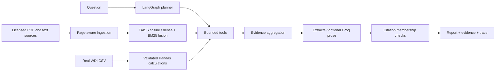

# AgriResearch AI

An agricultural research portfolio prototype combining document evidence,
national cereal statistics, bounded LangGraph workflows and reproducible
evaluation. Prepared for a Research Associate interview; not a published paper
or a production agronomic advisory system.

## Research problem and objectives

Agricultural questions often mix literature findings with numerical claims.
A useful assistant must expose which source supports an assertion, keep actual
measurements distinct from model interpretation, and explain unavailable data.
This project studies a small, inspectable implementation of those requirements.

The objectives are to retrieve page-level research evidence, analyze genuine
public observations without generated code, combine tools in a bounded workflow,
and measure retrieval/routing behavior with honest failure reporting.

## Features

- PDF/text extraction checks, configurable overlapping chunks and source hashes.
- Sentence Transformers + FAISS cosine baseline; BM25 reciprocal-rank fusion.
- Explicit TF-IDF fallback for constrained machines.
- LangGraph planning, tool execution, evidence aggregation, generation and checks.
- Allowlisted summary, YoY, trends, country comparisons and data-quality tools.
- Extractive citations without an API key; optional configured Groq interpretation.
- Streamlit chat, authorized session uploads, evidence inspection, CSV exploration
  and downloadable Markdown reports.
- Pytest unit/integration tests and a reproducible development-set evaluation.

## Architecture



See [design and folder structure](docs/ARCHITECTURE.md),
[source terms](docs/DATA_SOURCES.md), and [interview preparation](docs/INTERVIEW_PREPARATION.md).

## Stack and data

Python 3.11+, LangGraph, LangChain core (transitive), Sentence Transformers,
FAISS CPU, Streamlit, Pandas, NumPy, pypdf, Requests and Pytest. The embedding
model is `sentence-transformers/all-MiniLM-L6-v2`. Model code execution from the
Hub is disabled. [Attribution](THIRD_PARTY_NOTICES.md) records reused components.

Data: World Bank WDI / FAO cereal yield, production and harvested-area indicators
for Pakistan, India and Bangladesh, 2010–2023; a Pakistan wheat supplemental
irrigation paper from the Journal of Pure and Applied Agriculture. Exact
acquisition states, licenses and hashes appear in [source_manifest.csv](source_manifest.csv).
USDA guidance acquisition failed; FAO publication reuse review remains pending.
Neither is silently treated as available evidence.

The wheat paper has conflicting publisher license metadata. The project applies
the stricter CC BY-NC 4.0 condition and keeps the PDF out of Git; commercial
reuse needs clarification. WDI data retain their attribution/license terms.
The MIT code license does not relicense external data, papers or model weights.

## Installation (PowerShell)

```powershell
git clone https://github.com/Anees99/AgriResearch-AI.git
cd AgriResearch-AI
py -3.11 -m venv .venv
.\.venv\Scripts\python.exe -m pip install -r requirements.txt
Copy-Item .env.example .env
```

Use any supported Python interpreter in place of `py -3.11`. This workspace's
environment was created with `--system-site-packages` to reuse installed NumPy,
Pandas, Pytest, Requests and Streamlit. A fresh clone should use a clean venv;
the recorded local result is not proof of a clean installation on every platform.
`docs/environment_versions.txt` records the actual environment when available.

Download the documents that are deliberately excluded from Git:

```powershell
.\.venv\Scripts\python.exe scripts/fetch_sources.py
.\.venv\Scripts\python.exe scripts/fetch_paper.py
```

The first script rebuilds the source manifest. Run the paper script second.
Existing snapshots are included where terms allow, so avoid refreshing sources
before reproducing supplied results. Server revisions can change historical data.
No source-access credentials are required. Download errors must be resolved or
recorded as unavailable; never replace failed sources with fabricated text.

The default `MODEL_LOCAL_ONLY=true` uses cached model files. On a new machine,
set it to `false` for the initial model download, then restore it to `true`.
Model artifacts are not included in the repository. The model's own license
applies. CPU inference may require a substantial initial PyTorch download.
`docs/model_artifacts.json` fingerprints the post-run cached model snapshot.
The loaded Transformers config did not expose its commit identifier; the
inventory is explicitly not runtime attestation. Pin `EMBEDDING_REVISION` to the
recorded snapshot when reproducing these runs.

## Run and demonstrate

```powershell
.\.venv\Scripts\python.exe -m streamlit run streamlit_app.py
.\.venv\Scripts\python.exe -m agriresearch "What units are used to measure cereal yield?"
.\.venv\Scripts\python.exe -m agriresearch "Compare Pakistan cereal production in 2021 and 2022"
.\.venv\Scripts\python.exe -m agriresearch "Report on cereal harvest evidence and Pakistan average cereal yield" --output examples/demo_report.md
```

For the explicit lexical fallback add `--lexical`; `--baseline` disables hybrid
fusion. Generated indices are saved under `data/index` with JSON metadata.
The Streamlit app caches its in-memory retriever. Uploads remain session-local.

Example questions:

- Which wheat variety was used in the NARC supplemental irrigation experiment?
- Which statistical test compared wheat irrigation treatment means?
- Compare Pakistan cereal production in 2021 and 2022.
- Calculate wheat yield for Punjab in 2022. (Expected: unavailable.)
- Calculate Pakistan rainfall data in 2020. (Expected: unavailable.)

See [demonstration notes](examples/questions.md). Dataset explorer controls are
the clearest way to choose a country, variable, operation and years explicitly.
The narrow text planner defaults to Pakistan/cereal yield when filters are omitted.

## Configuration and credentials

`.env.example` documents model, provider, word chunk size/overlap, k, cosine
threshold and tool budget. No API subscription is required for extractive mode.
Optional synthesis uses `LLM_PROVIDER=groq`, `GROQ_API_KEY`, and `GROQ_MODEL`.
Select an available model and review your account's terms/limits before use.
Never commit `.env`, keys, secrets.toml or private uploads. No paid model calls
were used to produce the development evaluation.

## Tests and evaluation

```powershell
.\.venv\Scripts\python.exe -m pytest -q -m "not integration" --basetemp=.pytest-tmp-unit
.\.venv\Scripts\python.exe -m pytest -q -m integration --basetemp=.pytest-tmp-integration
.\.venv\Scripts\python.exe -m evaluation.run
.\.venv\Scripts\python.exe -m evaluation.run --lexical
```

The project-local test temp directory avoids this machine's inaccessible default
Windows Pytest temp folder. The chosen directory is disposable test output.

Evaluation uses source-reviewed development questions with document/page/span
labels, expected tool plans and unavailable-data requests. It compares semantic
cosine retrieval against hybrid retrieval at the same k and threshold. Agent
workflows are scored separately for enhanced mode. Numeric checks use independent
Pandas reference expressions against the frozen real CSV.

Metrics: evidence Recall@k, MRR, expected-answer-span presence, exact citation
membership, routing correctness, tool completion, unsupported-answer handling,
numeric correctness, latency and tool calls. Timing excludes model/index setup,
which is reported separately. Each case is measured once; there is no significance
or production-throughput claim. Labels were reviewed by the implementing agent,
not independently annotated by a human researcher.

### Actual results

Executed on 25 October 2026: **54 tests passed**, no skips or failures in the
final run. The semantic comparison used 12 inspected evidence questions at k=3:

| Retrieval system | Recall@3 | MRR |
|---|---:|---:|
| Semantic cosine baseline | 0.7500 | 0.7083 |
| Semantic + BM25 hybrid | 0.8333 | 0.7917 |
| Explicit lexical cosine fallback | 0.9167 | 0.8194 |

Lexical fallback used threshold 0.05 versus 0.28 for semantic retrieval, so it is
a separately configured run, not a controlled embedding ablation. The enhanced
agent selected expected tools in 8/8 workflow/negative cases and handled 4/4
unsupported requests after the disclosed scope-check fix. Static numeric gold
checks passed 2/2; independent arithmetic checks passed 3/3. Raw tool completion
was 6/8 because two unavailable-data requests correctly returned tool errors.
These are small development-set results, not independent research validation.

Measured status and tables are maintained in [evaluation/RESULTS.md](evaluation/RESULTS.md).
Raw per-question evidence, settings, dependency versions, corpus identity and
failures are stored in `evaluation/results.json` and `evaluation/results_lexical.json`
only after those experiments run. Unexecuted experiments must be marked not run.

## Limitations and research directions

This is a small English corpus, not comprehensive agricultural knowledge.
National cereal aggregates cannot answer district, crop-specific or weather
questions. PDF tables and column order may extract imperfectly; there is no OCR.
The source paper itself contains conflicting rainfall figures; the manifest and
answers carry a quality note. Quoted evidence can still be irrelevant, incomplete
or scientifically flawed. The verifier establishes membership, not entailment.
Optional model prose is explicitly unverified.
Recommendation questions have a conservative crop/location scope check, with
finite entity lists. Unknown upload scopes cannot establish recommendations.
The initial near-topic abstention failure and subsequent development fix are
preserved in `evaluation/results_initial.json` and the research report.

The planner uses rules and limited text filters. Multi-part requests can be
ambiguous; it is not an unrestricted autonomous research agent. No live provider
benchmark, human factuality study or production-readiness claim is made.
Questions run independently; conversational follow-up resolution is not implemented.

Next research steps: independently annotate a larger licensed multi-paper corpus,
hold out documents, test agricultural/multilingual embeddings and rerankers,
measure answer completeness/entailment with domain reviewers, calibrate abstention,
and add authorized local crop/weather data. See [RESEARCH_REPORT.md](RESEARCH_REPORT.md)
and [PROGRESS.md](PROGRESS.md) for current evidence and remaining work.
