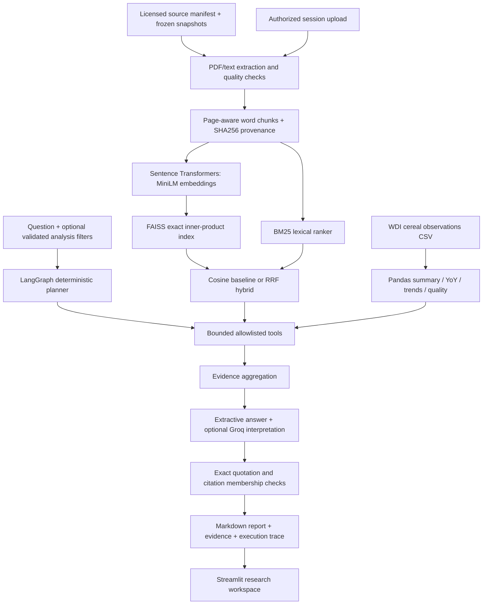

# Architecture and implementation scope



## Folder structure

```text
agriresearch/          configuration, ingestion, retrieval, analysis, graph, reports
streamlit_app.py       chat, source uploads, dataset explorer, evaluation viewer
scripts/              source acquisition with provenance and license checks
data/corpus/          licensed source documents and metadata
data/processed/       normalized real observations, missing values retained
data/raw/             local download snapshots (ignored in Git)
data/index/           generated FAISS index and JSON metadata (ignored in Git)
evaluation/           reviewed development labels, metrics, measured outputs
tests/                unit tests and marked integration tests
docs/                 design, interview notes, evidence review, data terms
examples/             demo prompts and an actually generated report
```

## Technical choices

- MiniLM gives compact CPU sentence embeddings; normalized vectors make inner
  product equivalent to cosine similarity. FAISS IndexFlatIP is exact and avoids
  approximate-search tuning for this small corpus.
- Baseline ranks by cosine. Hybrid uses reciprocal rank fusion (constant 60)
  of dense and BM25 ranks, retaining the same cosine eligibility threshold.
  Hybrid scores are rank scores, never probabilities.
- Word windows overlap but never cross PDF pages. IDs include file digest,
  page, position and chunk configuration. Original page numbers are 1-based.
  Text/web sources explicitly have no page. MiniLM can truncate token-dense
  chunks even at 110 words; tokenizer-aware splitting is future work.
- LangGraph executes explicit plan, execution, aggregation, generation,
  checking and finalization states. The rule planner is deliberately transparent;
  it is not a learned autonomous planner. Tool errors become state entries.
- Report requests reserve execution budget for reporting and verification.
  The graph is acyclic, has recursion limit 12, and allows at most 4 default
  tool calls. Acquisition retries at most twice after the initial attempt;
  provider synthesis has one request with a 30-second timeout.
- Structured operations use only Python functions with validated filters.
  No eval, generated Python, shell invocation or generated SQL is exposed.
- Research excerpts, calculated results, and optional model prose are separate.
  Recommendation-like questions also pass a conservative curated-scope guard:
  reviewed experimental crop/location metadata must cover recognized requested
  facets. Statistical definitions and unreviewed uploads cannot support these
  recommendations. The crop/location lexicons are finite, not a general
  entailment or geographic reasoning system.
  The verifier does not grade model interpretations. It checks exact excerpt
  membership and serialized calculation provenance. This avoids mistaking model
  self-assessment or citation existence for correctness.
- CSV data are small enough for Pandas; SQLite is unnecessary at this stage.
  Explicit metadata and snapshot hashes support reproducibility without hiding
  ingestion behind a framework. LangChain core is a LangGraph dependency;
  standalone LangChain document chains are not required.
- TF-IDF cosine is an explicit fallback. It is never reported as a semantic run.
- Groq is optional and disabled by default. Set model and key only after checking
  account terms/limits; no provider availability or free quota is guaranteed.

## Boundaries and risks

No authentication or production deployment is provided. Uploaded files are
limited to 20 MiB and 1000 session chunks; PDF parsing remains a trust boundary.
Uploads are session resources, never appended to the shared cached retriever.
Corpus documents and user text are untrusted evidence; synthesis has no tools.
Instructions in retrieved documents cannot trigger external actions.

Analyses default to Pakistan and cereal yield when omitted. Natural-language
parsing is narrow; use the dataset explorer's explicit controls for clarity.
National comparisons use available selected years and can have unequal coverage.
No causal, crop-specific, provincial, weather, or farm-treatment inference can
be made from national cereal indicators. No numeric imputation is performed.
Each question is an independent graph invocation. Chat history is displayed for
review, but conversational follow-up resolution and persistent memory are not implemented.

The index is saved by CLI/evaluation. Runtime rebuilds it from hash-checked
corpus snapshots; Streamlit caches the in-memory resource. Loading serialized
indices and incremental indexing are intentionally deferred at this scale.
